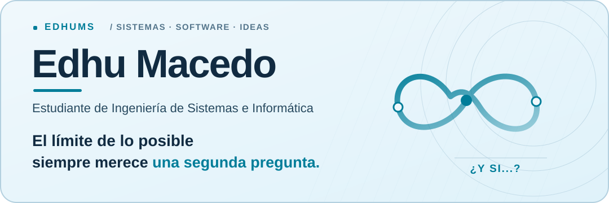
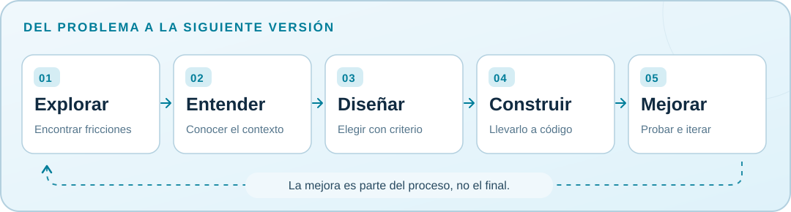

<!-- Perfil: github.com/EdhuMS -->

<picture>
  <source media="(prefers-color-scheme: dark)" srcset="./assets/hero-dark.svg">
  <source media="(prefers-color-scheme: light)" srcset="./assets/hero-light.svg">
  
</picture>

 

---

## 👨‍💻 Sobre mí

Soy **Edhu Macedo**, estudiante de **Ingeniería de Sistemas e Informática**.  
Me interesa **simplificar procesos, detectar oportunidades de mejora y construir soluciones tecnológicas que tengan sentido en la práctica**.

Disfruto cuestionar lo establecido, experimentar con nuevas herramientas y refinar lo que construyo.  
No me gusta dejar las cosas a medias: si algo puede mejorar, probablemente volveré a revisarlo.

> **“El límite de lo posible siempre merece una segunda pregunta.”**

---

## 🧠 Cómo pienso y construyo

<picture>
  <source media="(max-width: 600px) and (prefers-color-scheme: dark)" srcset="./assets/process-mobile-dark.svg">
  <source media="(max-width: 600px) and (prefers-color-scheme: light)" srcset="./assets/process-mobile-light.svg">
  <source media="(prefers-color-scheme: dark)" srcset="./assets/process-desktop-dark.svg">
  <source media="(prefers-color-scheme: light)" srcset="./assets/process-desktop-light.svg">
  
</picture>

Antes de programar, me gusta **entender el problema, definir el alcance y elegir el stack adecuado**.  
Después, procuro trabajar con una base clara: **organización, mantenibilidad, escalabilidad y mejora continua**.

---

## ⚙️ Stack principal

### Lenguajes y tecnologías base

  

### Frontend

  

### Backend

  

### Mobile

  

### Bases de datos

  
  
  

### Herramientas y despliegue

  

---

## 🚀 Lo que hago

- Desarrollo **soluciones tecnológicas para distintos sectores y contextos**.
- Trabajo con enfoque en **arquitectura, organización del código y escalabilidad**.
- Participo en proyectos donde el objetivo no es solo construir, sino también **mejorar procesos reales**.
- Parte de mi trabajo se encuentra en **repositorios privados**, especialmente soluciones internas y sistemas de gestión.

---

## 🤖 IA como herramienta de desarrollo

Utilizo herramientas como **ChatGPT, Codex y OpenCode** para acelerar análisis, desarrollo y prototipado.

Pero no las veo como sustituto del criterio técnico.  
Para mí, lo importante sigue siendo:

- definir bien el problema,
- tomar buenas decisiones de arquitectura,
- revisar el resultado,
- y mantener control sobre la solución final.

---

## 📈 En qué estoy enfocándome ahora

- 🏗️ **Arquitectura de software**
- 🧪 **Testing**
- ⚡ **Rendimiento y optimización**
- 📱 **Desarrollo móvil**
- 🧩 **Construcción de soluciones más mantenibles y escalables**

---

## 📊 Estadísticas de GitHub

  

---

## 🎯 Hacia dónde voy

Mi camino profesional es claro:

**prácticas profesionales → desarrollo / freelancing → consultoría tecnológica propia**

Quiero seguir creciendo como desarrollador, construyendo soluciones cada vez más sólidas, útiles y mejor pensadas.

---

## 📬 Conecta conmigo

---

  <strong>Edhu Macedo</strong> · Ingeniería de Sistemas e Informática · Perú

