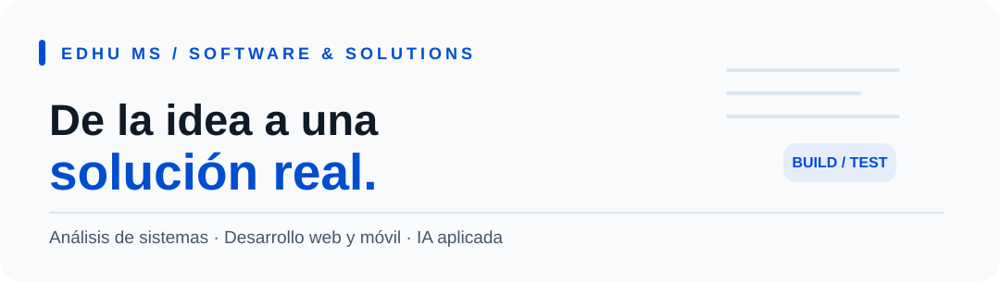
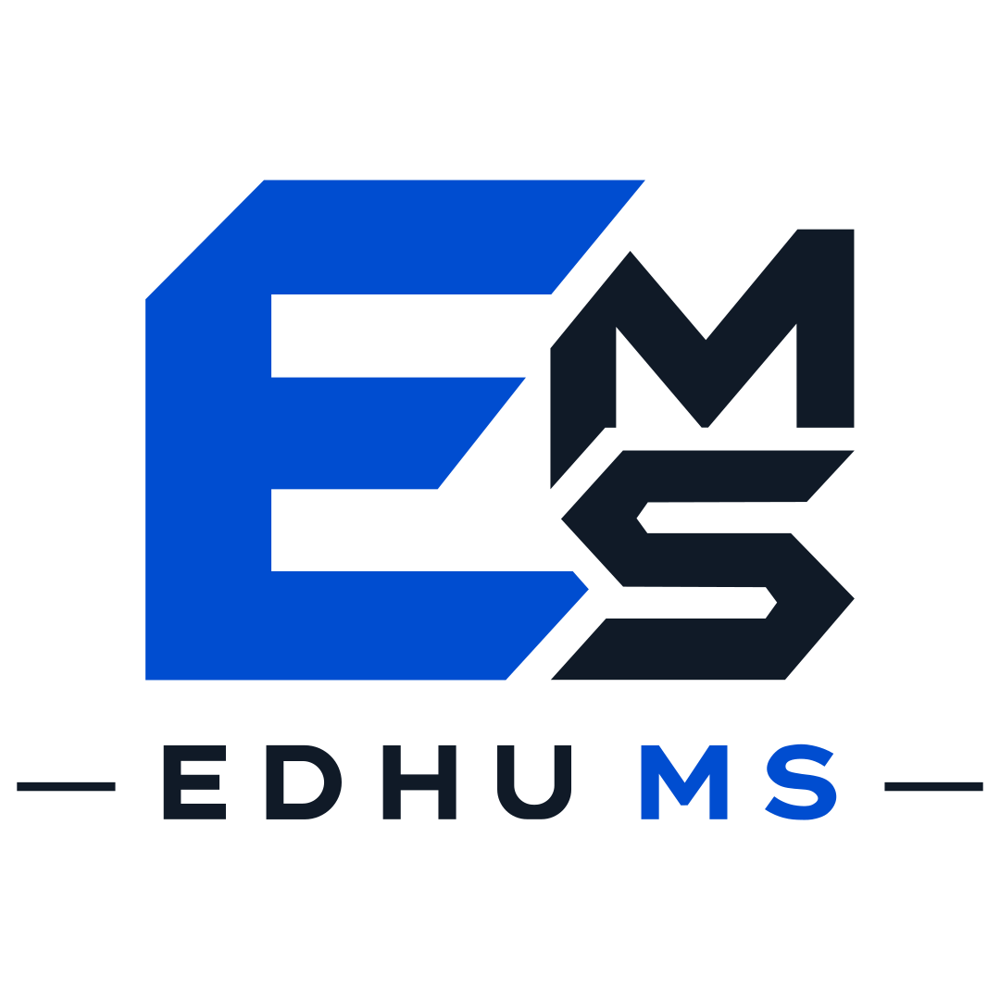
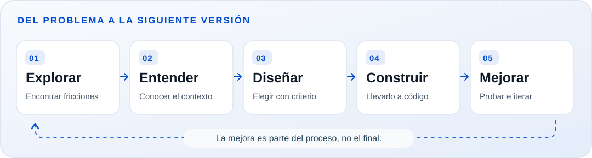
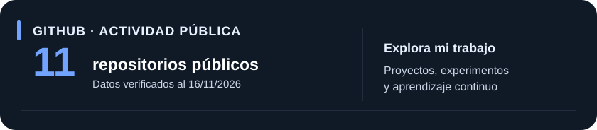

<!-- EDHU MS | Perfil personal · Identidad visual v2 -->

  <picture>
    <source media="(prefers-color-scheme: dark)" srcset="./assets/hero-edhu-dark.svg">
    <source media="(prefers-color-scheme: light)" srcset="./assets/hero-edhu-light.svg">
    
  </picture>
    
  <picture>
    <source media="(prefers-color-scheme: dark)" srcset="./assets/edhu-ms-logo-dark.svg">
    <source media="(prefers-color-scheme: light)" srcset="./assets/edhu-ms-logo-color.svg">
    
  </picture>
    
  
  
  

## ¡Hola! Soy Edhu 👋

Soy estudiante de **Ingeniería de Sistemas e Informática**. Me gusta entender cómo funciona un problema, encontrar oportunidades de mejora y diseñar soluciones que se utilicen de verdad.

Disfruto especialmente la etapa que muchas veces ocurre **antes de escribir código**: conversar sobre necesidades, definir requisitos, explorar alternativas, organizar la arquitectura y pensar cómo comprobar que el resultado funciona.

Me interesan el **análisis de sistemas**, el **desarrollo web y móvil** y la **inteligencia artificial aplicada**. Todavía tengo muchísimo por aprender, y parte de lo que hago aquí es compartir ese camino con proyectos reales y decisiones que puedo explicar.

> **«El límite de lo posible siempre merece una segunda pregunta».**

## Proyectos que me representan

[Ver mi portafolio personal](https://edhu-ms-portafolio.vercel.app/)

No son solo tecnologías en una lista: son problemas que he intentado comprender y resolver. Los estados que aparecen a continuación reflejan la documentación disponible, no una certificación independiente de producción.

| Proyecto | Qué problema aborda | Mi enfoque |
| --- | --- | --- |
| **Dhual Proformas** (repositorio privado) | Cotizaciones personalizadas para un negocio real, con experiencia web y Android. | Requisitos, flujo funcional, diseño y validación. README: MVP 1.0.0. |
| **Dhual Control** (repositorio privado) | Control interno de pedidos y saldos, con atención a permisos y seguridad. | Problema operativo, alcance y pruebas. Aplicación Android; validaciones de dispositivos pendientes según README. |
| **SDK SUNAT** (repositorio privado) | Componentes reutilizables para facturación electrónica peruana. | Investigación, arquitectura, reglas y pruebas. **Experimental; no afirmar autorización para emisión real.** |
| **Dhual Sport ERP** (repositorio privado) | Unificar procesos internos y operaciones empresariales. | Diseño de una solución de mayor alcance; desarrollo y aceptación por hitos. |

*En estos proyectos utilizo herramientas de IA y, según el caso, trabajo con colaboradores. Procuro diferenciar el análisis, las decisiones, las implementaciones y las pruebas realizadas por cada parte.*

## Herramientas de código abierto

También comparto herramientas y metodologías que pueden reutilizar otros desarrolladores:

- **[AI Project Documentation Skill](https://github.com/EdhuMS/ai-project-documentation-skill)** — Skill open source (MIT) para documentación técnica portable y handoffs verificables entre agentes de IA. Disponible en [español](https://github.com/EdhuMS/ai-project-documentation-skill/blob/main/README.es.md) e inglés.

*El licenciamiento de esta skill no se extiende automáticamente a mis demás proyectos ni a mi identidad visual.*

## Derechos de autor e identidad de marca

**© 2026 EdhuMS. Derechos reservados sobre el contenido original de este perfil.** Este repositorio se publica como presentación profesional y portafolio; **no se distribuye actualmente bajo MIT ni otra licencia abierta general**.

La lectura pública de este perfil no supone permiso general para copiar, adaptar, redistribuir o explotar comercialmente su contenido. La identidad visual **EDHU MS / EMS**, incluidos logos, monogramas, composiciones y banners, se trata específicamente en [Derechos de autor y recursos de marca](ASSETS-LICENSE.md).

Los repositorios de software enlazados desde este perfil pueden tener **licencias independientes** (por ejemplo, MIT), que deberán consultarse en cada proyecto. Los signos y recursos de terceros mantienen los derechos de sus titulares.

## Cómo pienso y construyo

  <picture>
    <source media="(max-width: 600px) and (prefers-color-scheme: dark)" srcset="./assets/process-edhu-mobile-dark.svg">
    <source media="(max-width: 600px) and (prefers-color-scheme: light)" srcset="./assets/process-edhu-mobile-light.svg">
    <source media="(prefers-color-scheme: dark)" srcset="./assets/process-edhu-desktop-dark.svg">
    <source media="(prefers-color-scheme: light)" srcset="./assets/process-edhu-desktop-light.svg">
    
  </picture>

**Explorar → Entender → Diseñar → Construir → Mejorar.** Mi parte favorita es pensar bien la solución y después ponerla a prueba. Un sistema no mejora simplemente por sumar funciones: a veces, mejorar significa quitar complejidad.

## Herramientas con las que trabajo

**Web y frontend**

**Móvil · explorando Android**

**Backend, datos y herramientas**

No domino todas estas tecnologías al mismo nivel. **React y el desarrollo web** son mi base; con **React Native y Kotlin** sigo ampliando mis conocimientos. Para diseñar soluciones también utilizo modelado de requisitos, pruebas funcionales y agentes de IA.

## Actividad en GitHub

  

*La tarjeta es una fotografía de los repositorios públicos al 16/11/2026, no una cifra en tiempo real. Para actividad y contribuciones actualizadas, visita [mi perfil de GitHub](https://github.com/EdhuMS). Algunos proyectos destacados son internos y sus repositorios no son públicos.*

---

## En qué estoy trabajando

- Fortalecerme en **análisis de sistemas e ingeniería de requisitos**.
- Profundizar en **aplicaciones móviles**, especialmente Android.
- Mejorar **arquitectura, seguridad y validación** de soluciones asistidas por IA.
- Construir un **portafolio web** con casos de estudio verificables.
- Conectar con la comunidad tecnológica y encontrar oportunidades de **prácticas profesionales**.

## Conversemos

Si te interesan el desarrollo de software, los proyectos que resuelven problemas reales o quieres intercambiar aprendizajes, estaré encantado de conversar.

**[LinkedIn](https://www.linkedin.com/in/edhu-ms/)** · **[Correo](mailto:edhums10@gmail.com)** · **[Repositorios](https://github.com/EdhuMS?tab=repositories)**

EDHU MS · Curiosidad, criterio y mejora continua · Perú

